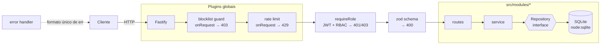
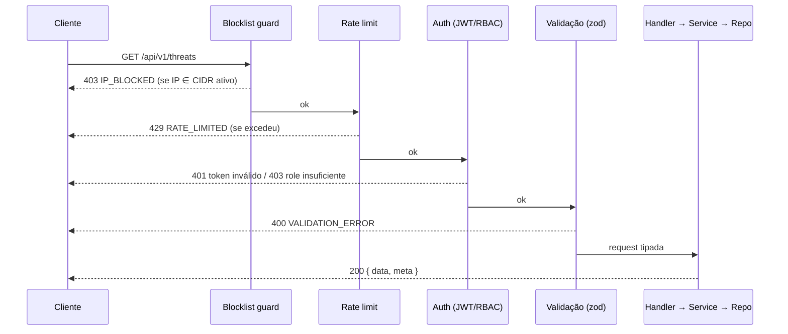

# security-api

```text
┌──(lucas㉿soc)-[~/security-api]
└─$ ./status
[+] runtime ........ Node.js 22+ · TypeScript strict · ESM
[+] framework ...... Fastify 5 + zod (validação e OpenAPI a partir do mesmo schema)
[+] auth ........... JWT (HS256) · RBAC admin/analyst · senhas com scrypt
[+] defense ........ blocklist IP/CIDR (IPv4 + IPv6) aplicada em toda requisição
[+] throttling ..... rate limit por IP + limite dedicado no login
[+] storage ........ SQLite (node:sqlite) com migrations versionadas
[+] observability .. logs estruturados (pino) · request-id em toda resposta
[+] docs ........... OpenAPI 3 + Swagger UI em /docs
```

API REST de segurança para registrar **ameaças**, gerenciar **alertas** e manter uma **blocklist de IPs/CIDR** que é efetivamente aplicada pelo próprio servidor. Projeto de portfólio com foco em decisões que eu consigo explicar linha a linha: arquitetura em camadas, validação na borda, autenticação/autorização, testes automatizados e CI.

> A versão 1.0 era um único `server.ts` com Express e dados em memória. A 2.0 é uma reescrita completa — veja [Decisões de design](#-decisões-de-design).

---

## ⚡ Funcionalidades

- **Ameaças (`threats`)** — cadastro, listagem com filtros (`severity`, `resolved`, `sourceIp`) e paginação, resolução e exclusão.
- **Alertas (`alerts`)** — mesmo ciclo de vida, ordenados por severidade (critical → low) e depois por data.
- **Blocklist** — aceita IP único ou bloco CIDR (`203.0.113.0/24`, `2001:db8::/32`), com expiração opcional e contador de hits. Um hook global devolve **403** para qualquer IP coberto por uma regra ativa — inclusive com token válido.
- **Autenticação** — `POST /auth/login` devolve um JWT de curta duração; admin inicial criado a partir de variáveis de ambiente.
- **RBAC** — `analyst` lê, cria e resolve; apenas `admin` exclui registros, altera a blocklist e cria usuários.
- **Rate limiting** — limite global por IP (contado _antes_ da autenticação) e limite mais rígido no login contra brute force.
- **Erros padronizados** — toda falha sai no mesmo formato JSON, com `code` estável e `requestId` para correlacionar com os logs.
- **Hardening** — headers de segurança via `@fastify/helmet`, CORS desligado por padrão, `alg` do JWT fixado em HS256, mensagens de 5xx nunca vazam detalhes internos.

## 🧱 Arquitetura

Cada módulo segue **routes → service → repository**:

- **routes**: HTTP puro — schema zod (validação + documentação), hooks de auth, status codes.
- **service**: regra de negócio (normalizar CIDR, impedir resolução dupla, expiração...). Não conhece HTTP nem SQL.
- **repository**: interface + implementação SQLite. Os métodos são `async` mesmo com o driver síncrono, para que uma implementação PostgreSQL possa substituir a atual sem mudar os services.



Ciclo de vida de uma requisição protegida:



### Estrutura

```text
security-api/
├── migrations/                 # SQL versionado (001_initial_schema.sql)
├── src/
│   ├── app.ts                  # composition root: db → repos → services → plugins → rotas
│   ├── server.ts               # entrypoint: config, listen, graceful shutdown
│   ├── config/env.ts           # variáveis de ambiente validadas com zod (fail fast)
│   ├── db/                     # conexão, runner de migrations, seed de demo
│   ├── lib/                    # ip/CIDR, hashing de senha, classes de erro
│   ├── plugins/                # auth, rate-limit, blocklist-guard, error-handler, swagger
│   ├── shared/schemas.ts       # paginação, severidade, IP, formato de erro
│   └── modules/
│       ├── auth/               # login, /me, criação de usuários
│       ├── threats/
│       ├── alerts/
│       └── blocklist/
├── test/
│   ├── unit/                   # CIDR, senha, config, services
│   └── integration/            # app.inject(): auth, RBAC, validação, blocklist, rate limit
├── Dockerfile                  # multi-stage, usuário não-root
└── .github/workflows/ci.yml    # lint · format · typecheck · test · build
```

## 🛰️ Endpoints

Base: `/api/v1`. Todas as rotas, exceto `login` e `health`, exigem `Authorization: Bearer <token>`.

| Método   | Rota                          | Acesso         | Descrição                                                             |
| -------- | ----------------------------- | -------------- | --------------------------------------------------------------------- |
| `GET`    | `/health`                     | público        | Liveness/readiness (verifica o banco)                                 |
| `GET`    | `/docs`                       | público        | Swagger UI (`/docs/json` = OpenAPI)                                   |
| `POST`   | `/api/v1/auth/login`          | público        | Troca usuário/senha por JWT (limite próprio por IP)                   |
| `GET`    | `/api/v1/auth/me`             | admin, analyst | Usuário autenticado                                                   |
| `POST`   | `/api/v1/auth/users`          | admin          | Cria usuário (`analyst` por padrão)                                   |
| `GET`    | `/api/v1/threats`             | admin, analyst | Lista — filtros `severity`, `resolved`, `sourceIp`, `limit`, `offset` |
| `GET`    | `/api/v1/threats/:id`         | admin, analyst | Detalhe                                                               |
| `POST`   | `/api/v1/threats`             | admin, analyst | Registra ameaça                                                       |
| `PATCH`  | `/api/v1/threats/:id/resolve` | admin, analyst | Marca como resolvida (409 se já estiver)                              |
| `DELETE` | `/api/v1/threats/:id`         | admin          | Remove                                                                |
| `GET`    | `/api/v1/alerts`              | admin, analyst | Lista — filtros `severity`, `resolved`, `limit`, `offset`             |
| `GET`    | `/api/v1/alerts/:id`          | admin, analyst | Detalhe                                                               |
| `POST`   | `/api/v1/alerts`              | admin, analyst | Cria alerta                                                           |
| `PATCH`  | `/api/v1/alerts/:id/resolve`  | admin, analyst | Marca como resolvido                                                  |
| `DELETE` | `/api/v1/alerts/:id`          | admin          | Remove                                                                |
| `GET`    | `/api/v1/blocklist`           | admin, analyst | Regras ativas (`includeExpired=true` para todas)                      |
| `GET`    | `/api/v1/blocklist/check?ip=` | admin, analyst | Diz se um IP está bloqueado e por qual regra                          |
| `POST`   | `/api/v1/blocklist`           | admin          | Bloqueia IP ou CIDR (normalizado: `10.1.2.3/8` → `10.0.0.0/8`)        |
| `DELETE` | `/api/v1/blocklist/:id`       | admin          | Remove regra (desbloqueio imediato)                                   |

### Formato de erro

```json
{
  "statusCode": 400,
  "error": "Bad Request",
  "code": "VALIDATION_ERROR",
  "message": "Request validation failed",
  "details": {
    "location": "body",
    "issues": [{ "path": "sourceIp", "message": "Must be a valid IPv4 or IPv6 address" }]
  },
  "requestId": "0b6c1c1e-0d0f-4a51-9a52-6f4f1f7a3c11"
}
```

Códigos usados: `VALIDATION_ERROR`, `INVALID_CREDENTIALS`, `INVALID_TOKEN`, `FORBIDDEN`, `IP_BLOCKED`, `NOT_FOUND`, `CONFLICT`, `RATE_LIMITED`, `INTERNAL_ERROR`.

## 🚀 Como rodar

Requisitos: **Node.js 22.13+** (usa o módulo nativo `node:sqlite`; nenhuma dependência compilada).

```bash
git clone https://github.com/Luca-css/security-api.git
cd security-api
npm install
cp .env.example .env          # troque JWT_SECRET e ADMIN_PASSWORD
npm run dev                   # http://localhost:3000  ·  docs em /docs
```

Produção:

```bash
npm run build
npm start
```

Exemplo rápido:

```bash
# login
TOKEN=$(curl -s -X POST localhost:3000/api/v1/auth/login \
  -H 'content-type: application/json' \
  -d '{"username":"admin","password":"change-me-please-123"}' | jq -r .accessToken)

# bloquear uma faixa inteira
curl -X POST localhost:3000/api/v1/blocklist \
  -H "authorization: Bearer $TOKEN" -H 'content-type: application/json' \
  -d '{"cidr":"203.0.113.0/24","reason":"botnet","expiresAt":"2030-01-01T00:00:00Z"}'

# consultar
curl "localhost:3000/api/v1/blocklist/check?ip=203.0.113.50" -H "authorization: Bearer $TOKEN"
```

> ⚠️ Cuidado ao bloquear `127.0.0.1`, a sua própria rede ou `0.0.0.0/0`: o guard vale para todas as rotas, inclusive as de administração. Para desfazer, remova a linha da tabela `blocklist` no arquivo SQLite.

### Docker

```bash
docker build -t security-api .
docker run --rm -p 3000:3000 \
  -e JWT_SECRET="$(openssl rand -base64 48)" \
  -e ADMIN_PASSWORD='uma-senha-forte-aqui' \
  -v security-api-data:/app/data \
  security-api
```

Imagem multi-stage (`node:22-alpine`): o estágio final contém só `dist/`, dependências de produção e as migrations, roda como usuário `node` (não-root) e tem `HEALTHCHECK` em `/health`.

## ⚙️ Variáveis de ambiente

Validadas com zod na inicialização — se algo estiver errado, o processo encerra com uma mensagem clara.

| Variável               | Padrão                   | Descrição                                                     |
| ---------------------- | ------------------------ | ------------------------------------------------------------- |
| `NODE_ENV`             | `development`            | `development` ativa logs legíveis (pino-pretty)               |
| `HOST` / `PORT`        | `0.0.0.0` / `3000`       | Endereço de escuta                                            |
| `LOG_LEVEL`            | `info`                   | `fatal` … `trace`, ou `silent`                                |
| `DATABASE_PATH`        | `./data/security-api.db` | Arquivo SQLite (`:memory:` nos testes)                        |
| `JWT_SECRET`           | — **obrigatório**        | Mínimo 32 caracteres                                          |
| `JWT_EXPIRES_IN`       | `15m`                    | Validade do access token (`30s`, `15m`, `1h`, `1d`)           |
| `ADMIN_USERNAME`       | `admin`                  | Admin criado somente se a tabela `users` estiver vazia        |
| `ADMIN_PASSWORD`       | — **obrigatório**        | Mínimo 12 caracteres                                          |
| `RATE_LIMIT_MAX`       | `100`                    | Requisições por IP por janela                                 |
| `RATE_LIMIT_WINDOW_MS` | `60000`                  | Tamanho da janela                                             |
| `LOGIN_RATE_LIMIT_MAX` | `5`                      | Tentativas de login por IP por minuto                         |
| `TRUST_PROXY`          | `false`                  | Usar `X-Forwarded-For`. **Só ative atrás de um proxy seu**    |
| `CORS_ORIGIN`          | vazio (desligado)        | Lista separada por vírgula                                    |
| `SEED_DEMO_DATA`       | `false`                  | Popula ameaças/alertas/blocklist de exemplo com o banco vazio |

## 🧪 Testes e qualidade

```bash
npm test             # Vitest: unitários + integração
npm run lint         # ESLint (typescript-eslint com regras type-aware)
npm run format:check # Prettier
npm run typecheck    # tsc --noEmit (strict + noUncheckedIndexedAccess)
```

- **Unitários** — matching CIDR IPv4/IPv6 (bordas de prefixo, `/0`, `/32`, IPv4-mapped, formatação RFC 5952), hashing de senha, validação de config, `BlocklistService` (normalização, duplicatas, expiração com relógio injetado) e `ThreatService` com um repositório _fake_ em memória.
- **Integração** — `app.inject()` sobre a aplicação real com SQLite em memória: fluxo de login, tokens adulterados / de outro segredo / `alg: none`, 403 de RBAC, 400 de validação (body, query, params, JSON malformado), blocklist aplicada por CIDR e IPv6, rate limit global e do login, OpenAPI gerado.

O CI (`.github/workflows/ci.yml`) roda lint, format check, typecheck, testes e build em Node 22 e 24 a cada push/PR.

## 🧠 Decisões de design

**Por que Fastify e não Express?** Fastify tem validação/serialização por schema embutida, hooks bem definidos no ciclo de vida (o que torna explícito _onde_ a blocklist, o rate limit e a autenticação rodam), encapsulamento de plugins e suporte nativo a TypeScript. Com `fastify-type-provider-zod`, o mesmo schema zod valida a entrada, tipa o handler, filtra a resposta (não vaza `passwordHash`) e gera o OpenAPI.

**Por que `node:sqlite`?** Zero dependência nativa para compilar (o `better-sqlite3` exige toolchain em Windows/versões novas do Node). Para um serviço deste tamanho, SQLite com WAL é suficiente; a interface de repositório deixa a troca por PostgreSQL localizada.

**Por que scrypt?** Está no `node:crypto`, é _memory-hard_ e evita dependência nativa (bcrypt/argon2). O hash guarda os parâmetros (`scrypt$N$r$p$salt$hash`) para permitir aumentar o custo no futuro. A comparação usa `timingSafeEqual`, e um usuário inexistente também custa um cálculo de scrypt — mesma resposta e tempo parecido, dificultando enumeração de usuários.

**Blocklist em `onRequest`.** É o primeiro hook do ciclo do Fastify: o IP bloqueado recebe 403 antes de parsing do body, validação, JWT ou rate limit — o servidor não gasta trabalho com o payload. As regras ficam pré-processadas em memória (CIDR → `BigInt` + prefixo) e o cache é recarregado quando uma regra muda; a verificação é `(ip & mask) === network`. Endereços IPv4-mapped (`::ffff:1.2.3.4`) são normalizados para IPv4.

**Rate limit antes da autenticação.** O limitador roda como hook de instância, que executa antes dos hooks de rota. Se ele rodasse depois do `requireRole`, um atacante sem token receberia 401 indefinidamente sem nunca ser limitado — isso foi detectado por um teste de integração durante o desenvolvimento.

**`TRUST_PROXY`.** Desligado por padrão. Ligado sem um proxy confiável na frente, qualquer cliente poderia forjar `X-Forwarded-For` e burlar tanto a blocklist quanto o rate limit.

**Booleans em query string/env.** `z.coerce.boolean()` transforma a string `"false"` em `true`; por isso há um parser explícito para `"true"`/`"false"` (coberto por teste).

## 🗺️ Limitações conhecidas / próximos passos

- Rate limit e cache da blocklist são **por processo**. Com várias réplicas, seria necessário Redis (rate limit) e invalidação distribuída do cache.
- Apenas access token, sem refresh token nem revogação (mitigado pela validade curta de 15 min).
- Matching da blocklist é linear — ok para centenas/milhares de regras; para feeds grandes, uma árvore de prefixos (radix trie).
- Não há endpoint para trocar senha ou desativar usuários.
- O `Dockerfile` segue práticas padrão, mas não foi executado no ambiente onde este projeto foi desenvolvido.
- Os endpoints `POST /api/scan` e `GET /api/stats` da v1 foram removidos: o scan gerava portas/CVEs pseudo-aleatórios e as estatísticas tinham valores fixos (ex.: `monitoredHosts: 42`), ou seja, não representavam dados reais.

## 📄 Licença

[MIT](LICENSE) © 2026 Lucas Santos
